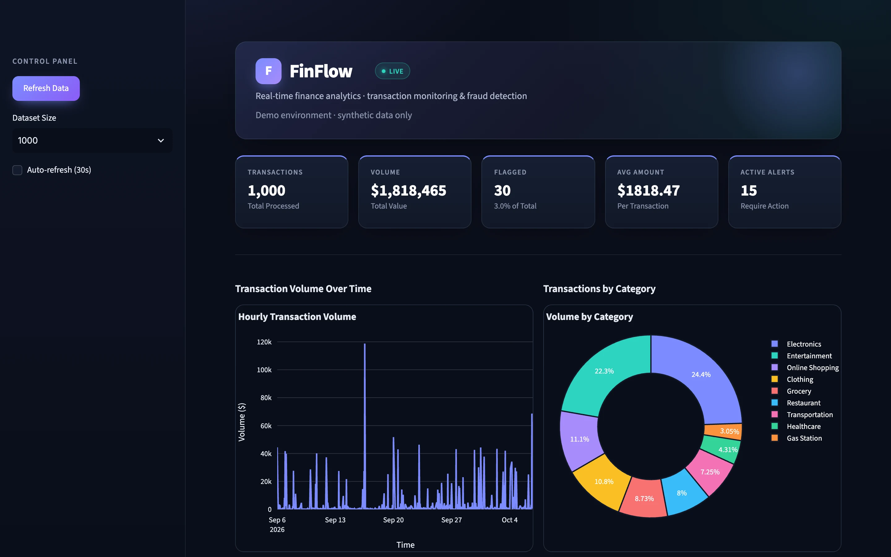
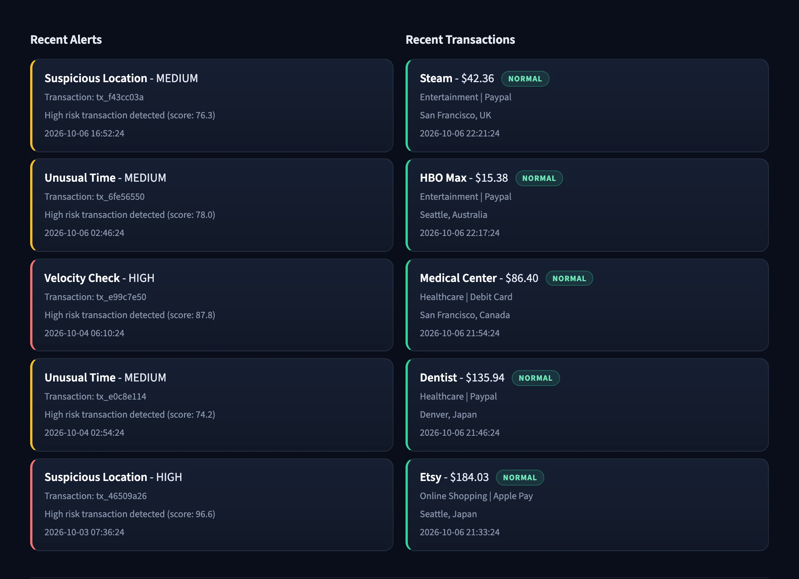
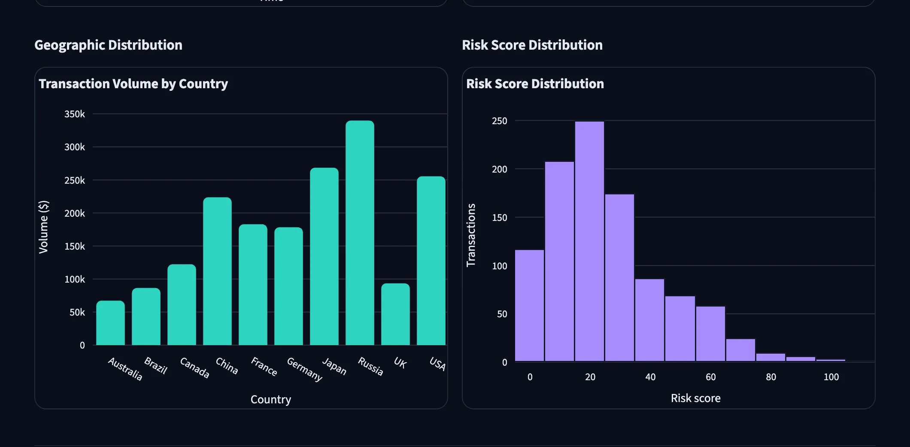
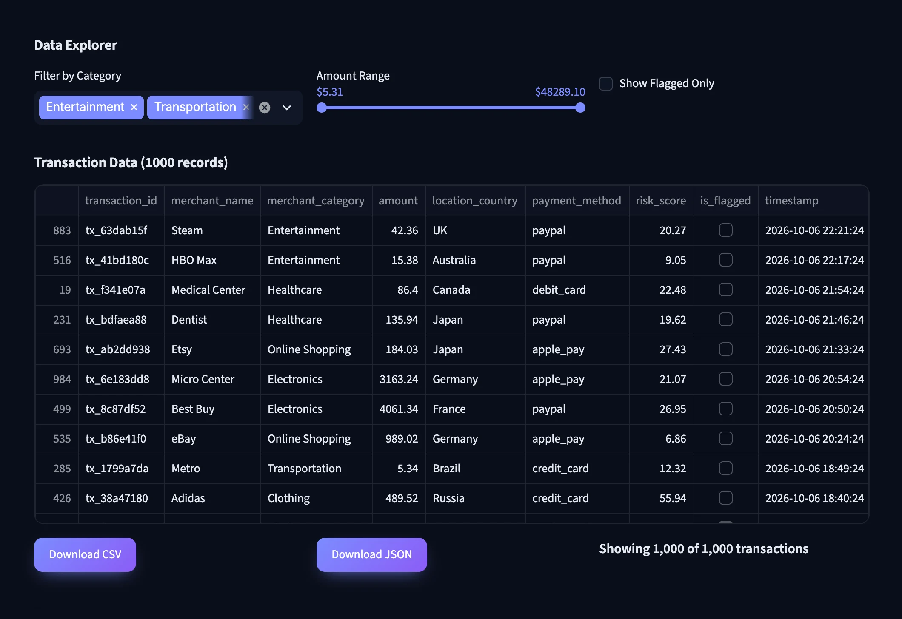
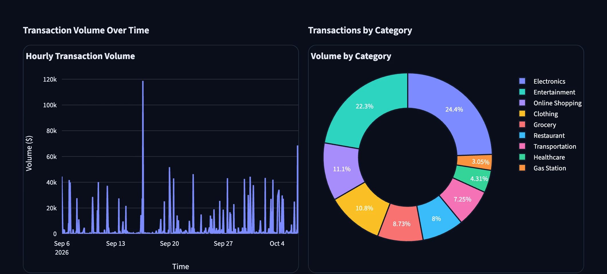
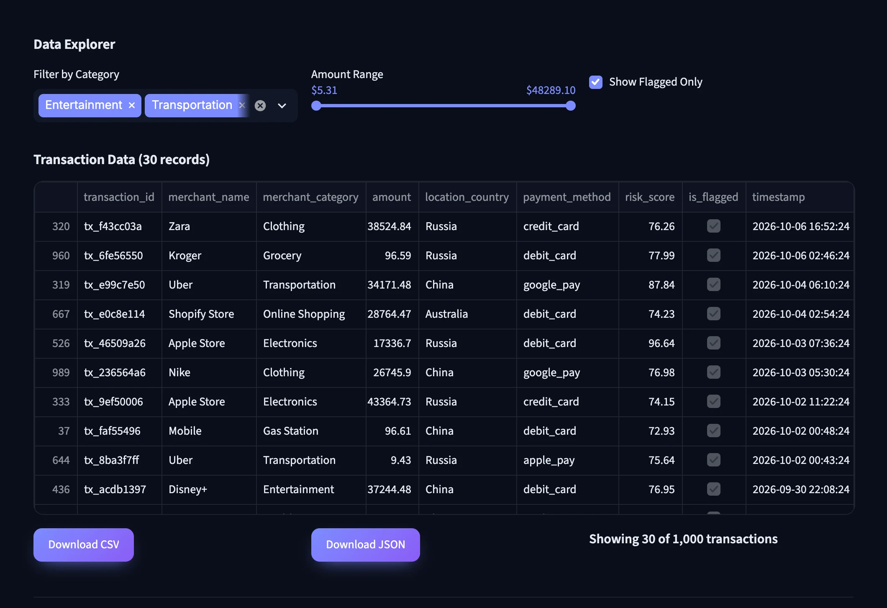
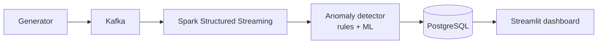

# FinFlow

**A real-time finance analytics dashboard for transaction monitoring and fraud detection, built around a Kafka, Spark and PostgreSQL streaming pipeline.**

**Web dashboard** 
Python · Streamlit · Plotly · Kafka · PySpark · PostgreSQL · scikit-learn

<table>
  <tr>
    <td></td>
    <td></td>
  </tr>
  <tr>
    <td></td>
    <td></td>
  </tr>
</table>
Screenshots are real captures of a local build running on fictional demo data.

---

## Important: what is real in this demo

The Kafka, Spark and PostgreSQL pipeline, including the anomaly detector, is in the codebase. The demo shown here does not run it. It runs a self-contained Streamlit dashboard on generated fictional data (Faker and NumPy), and its risk scores and flags are randomly generated.

## Product at a Glance

| | |
|---|---|
| **What it is** | A transaction monitoring dashboard with KPI cards, charts, alert cards and a filterable data explorer |
| **Platform** | Web (Streamlit) |
| **Designed pipeline** | Synthetic generator, Kafka, PySpark Structured Streaming, anomaly detector, PostgreSQL, Streamlit |
| **Detection (in code)** | Rule checks (amount, velocity, time, geography, merchant) plus IsolationForest and DBSCAN models and per-user profiles |
| **Demo** | Standalone dashboard on fictional generated data, with dataset size selector and refresh |
| **Export** | CSV and JSON download from the Data Explorer |
| **Orchestration** | Docker Compose, Makefile and CLI launchers |
| **Code size** | About 6.4k lines of Python |

## Product Showcase

<table>
  <tr>
    <td align="center"> <b>Volume and categories</b> Hourly volume and share by category</td>
    <td align="center"> <b>Geography and risk</b> Volume by country, risk score distribution</td>
  </tr>
  <tr>
    <td align="center"> <b>Alerts and transactions</b> Severity-coded alert cards, status badges</td>
    <td align="center"> <b>Flagged only</b> Explorer narrowed to flagged records</td>
  </tr>
</table>

## Key Features

- **KPI cards.** Transactions, volume, flagged count, average amount and active alerts.
- **Charts.** Hourly volume line chart, category donut chart, country bar chart and risk score histogram, styled with a consistent palette.
- **Alerts and recent transactions.** Card lists with severity colours and status badges.
- **Data Explorer.** Category filter, amount range slider, flagged-only toggle, and CSV and JSON download.
- **Sidebar controls.** Refresh, dataset size selector and optional auto-refresh.
- **Detection design.** Rule checks, scikit-learn models and per-user profiles combined into one risk score (in the codebase, not exercised by the demo).

## Engineering Highlights

- **Streaming design.** Kafka feeds a Spark Structured Streaming job that scores each micro-batch with the anomaly detector and runs sliding-window aggregations by country and category.
- **Layered detection.** Five rule checks, IsolationForest and DBSCAN models and per-user profile statistics are combined into one risk score with alerts.
- **Stack orchestration.** Docker Compose defines PostgreSQL, Zookeeper, Kafka, Spark and the application containers, with a Makefile and CLI launchers.
- **Modern-library compatibility.** A small wrapper shims removed Streamlit and pandas APIs so the original demo runs on current versions without editing it.
- **Presentation layer.** The dashboard is styled through injected CSS and a Streamlit theme, with no changes to the dashboard's logic.

More: [docs/ENGINEERING_CHALLENGES.md](docs/ENGINEERING_CHALLENGES.md).

## Architecture

Details: [docs/ARCHITECTURE.md](docs/ARCHITECTURE.md).

## Status & Scope

- **Demo mode.** The screenshots come from a standalone dashboard on generated fictional data. No real transactions or people are shown.
- **Real code, not run here.** The Kafka producer and consumer, Spark processor, anomaly detector and PostgreSQL layer are in the codebase. The full stack needs Docker and was not run for this portfolio.
- **Mock in the demo.** Risk scores, flags and alerts are randomly generated rather than produced by the detector.
- **Compatibility wrapper.** The demo runs through a small wrapper for current Streamlit and pandas versions.
- **Source.** Production source is private; this repository holds documentation and screenshots only.

## Documentation

- [Product overview](docs/PRODUCT_OVERVIEW.md)
- [Architecture](docs/ARCHITECTURE.md)
- [Technical case study](docs/TECHNICAL_CASE_STUDY.md)
- [Engineering challenges](docs/ENGINEERING_CHALLENGES.md)
- [Privacy and source](docs/PRIVACY_AND_SOURCE.md)

## Rights

See [RIGHTS.md](RIGHTS.md).
