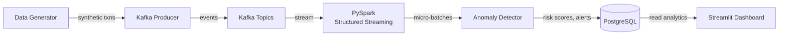
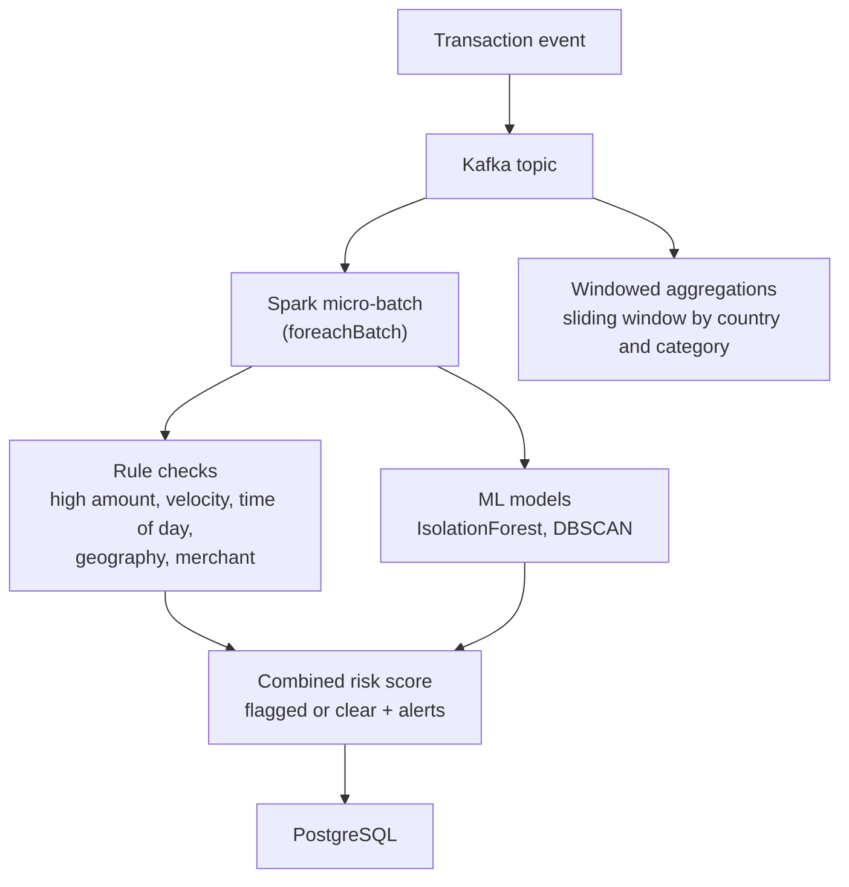

# Architecture

All diagrams are original and describe system responsibilities and data flow as designed in the codebase. The demo shown in the screenshots runs only the Streamlit dashboard on generated fictional data; the Kafka, Spark and PostgreSQL pipeline below is in the codebase but was not run for this portfolio.

## System overview

Synthetic transactions are published to Kafka, read by a Spark Structured Streaming job, scored per micro-batch by the anomaly detector, written to PostgreSQL and visualised in Streamlit.

## Processing pipeline

Each micro-batch is converted to pandas and passed through the anomaly detector, which combines rule-based checks with scikit-learn models and per-user profiles. A separate streaming query computes sliding-window aggregations (counts, totals, averages, flagged counts) by country and merchant category.

## Deployment model

The full system is described by a Docker Compose file covering PostgreSQL, Zookeeper, Kafka, a Kafka UI, Spark master and worker containers, and the application containers. A Makefile and CLI launchers wrap the common commands. The demo dashboard runs as a standalone Python script that needs only Streamlit, Plotly, pandas, NumPy and Faker.
